# AI-First Software Engineering & Context Architecture: Google Antigravity CLI (`agy`) Masterclass

Welcome to the comprehensive technical guide for the **GDG Lisbon AI-First Engineering Code-Along Masterclass**. In this hands-on workshop, we move beyond ad-hoc "chatting with an LLM" and architect a complete, deterministic **Context Engineering & Governance System** for software teams using the **Google Antigravity CLI (`agy`)**.

Rather than relying on fragile, one-off "magic prompts" that evaporate at the end of a chat session, this workshop demonstrates how to encode your team's architectural boundaries, operational runbooks, quality gates, and external tool integrations directly into your Git repository using **Rules (`AGENTS.md`)**, **On-Demand Skills (`SKILL.md`)**, **Deterministic Lifecycle Hooks (`hooks.json`)**, **Model Context Protocol (`mcp_config.json`)**, and **Shareable Plugins (`plugin.json`)**.

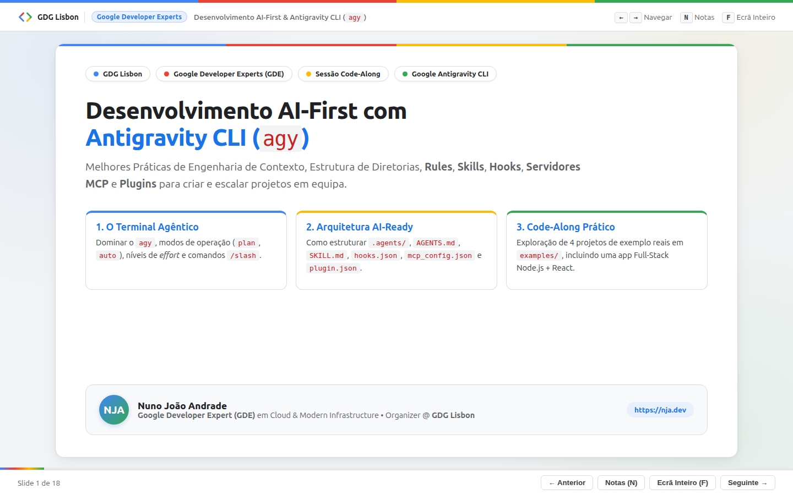

> [!NOTE]
> **Key Architectural Goal**: Transform an autonomous coding agent from an unpredictable code generator into a disciplined engineering partner with bounded context consumption (`20,000-token` rule budget + progressive skill disclosure), zero-downtime migration validation, deterministic `PreToolUse` / `PostToolUse` safety hooks, and contract-first full-stack verification.

---

## About the Speaker & GDG Lisbon Community

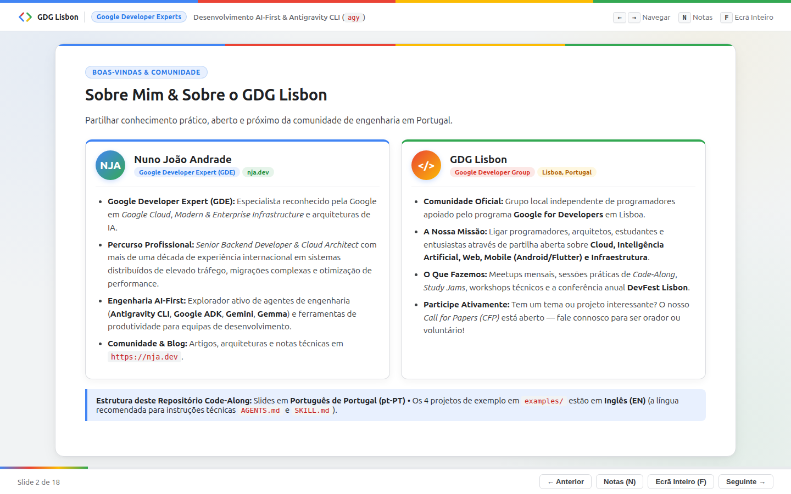

This workshop was created for the **Google Developer Group (GDG) Lisbon** community by **Nuno João Andrade** ([nja.dev](https://nja.dev)), **Google Developer Expert (GDE)** in Google Cloud & Modern Infrastructure and Senior Backend & Cloud Architect.

- **Repository Strategy (Bilingual by Design)**: All presentation slides (`slides/`) and the root workshop overview are provided in **European Portuguese (`pt-PT`)** for live delivery, while all five hands-on project directories (`examples/00-*` through `examples/04-*`), `AGENTS.md` files, and `SKILL.md` definitions are written in **English (`EN`)**—the recommended language for maximizing instruction-following precision and token efficiency in frontier LLMs.

---

## The AI Engineering Paradigm Shift: Ad-Hoc Chat vs. AI-First Context Engineering

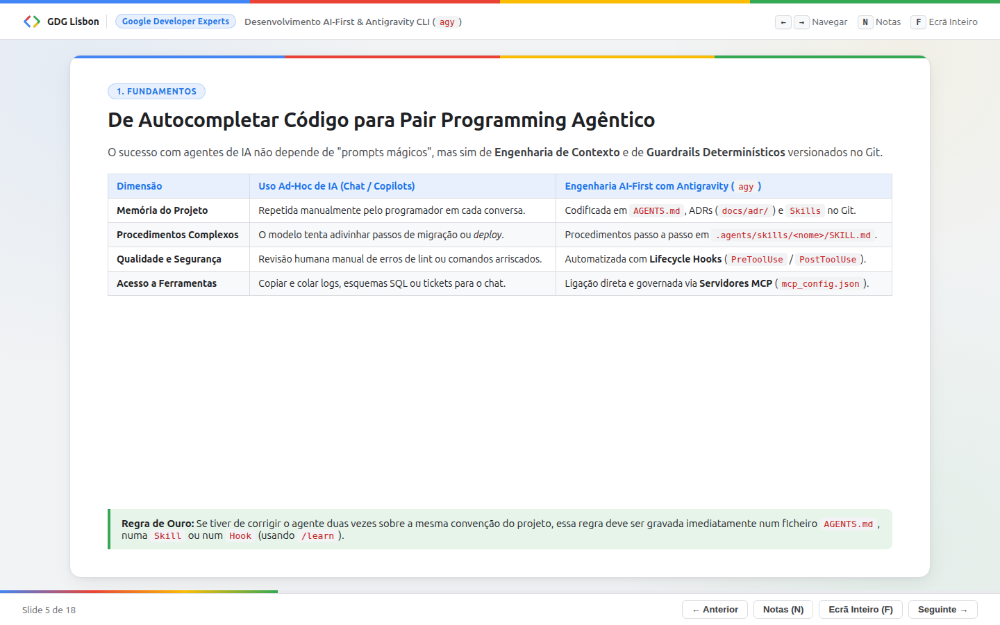

When engineering teams adopt AI coding assistants without a repository-level context architecture, they quickly encounter context drift: the model forgets architectural boundaries, proposes deprecated libraries, skips unit tests, or executes risky shell commands. Comparing ad-hoc AI usage with structured **AI-First Engineering** highlights why version-controlled governance is essential:

| Dimension | Ad-Hoc AI Usage (Chat / Basic Copilots) | AI-First Engineering with Antigravity (`agy`) |
| :--- | :--- | :--- |
| **Project Memory** | Repeated manually by the developer in every chat session | Versioned in Git via hierarchical `AGENTS.md` files, ADRs (`docs/adr/`), and `Skills` |
| **Complex Workflows** | The LLM guesses migration, scaffolding, or release steps | Step-by-step runbooks loaded on-demand from `.agents/skills/<name>/SKILL.md` |
| **Quality & Safety** | Manual human review catching lint errors or destructive commands | Enforced deterministically via synchronous **Lifecycle Hooks** (`PreToolUse`, `PostToolUse`, `Stop`) |
| **External Systems** | Copy-pasting SQL schemas, service logs, or incident metrics into chat | Governed, structured access via **Model Context Protocol (MCP)** (`mcp_config.json`) |
| **Context Window Health** | Dumping massive 50-page docs into the prompt, degrading attention | **Progressive Disclosure**: lightweight metadata at startup, deep references read only on demand |

> [!TIP]
> **The Golden Rule of Agentic Engineering**: If you have to correct the agent twice about the same project convention, that rule belongs in `AGENTS.md`, a `Skill`, or a `Hook` (or persisted immediately via the `/learn` slash command).

---

## System Architecture Blueprint & The 5 Customization Pillars

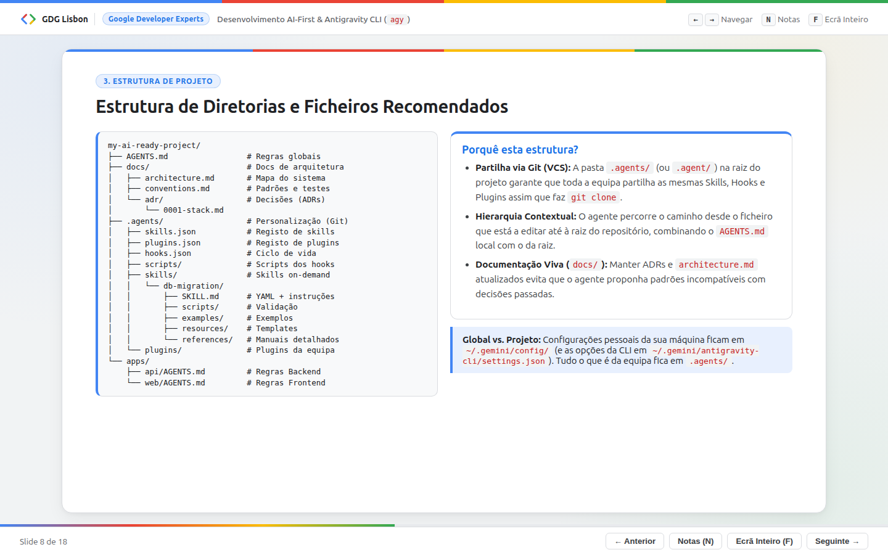

An AI-Ready repository separates **human-and-agent architecture docs (`docs/`)**, **always-on contextual rules (`AGENTS.md`)**, and **modular agent customizations (`.agents/`)**:

```text
+-----------------------------------------------------------------------------------+
|                        AI-Ready Repository Architecture                           |
+-----------------------------------------------------------------------------------+
         |                                    |                                 |
         v                                    v                                 v
+------------------------+     +------------------------------+     +---------------+
| Contextual Rules       |     | .agents/ Customization Root  |     | Living Docs   |
| (Hierarchical)         |     | (Versioned in Git)           |     | (docs/)       |
+------------------------+     +------------------------------+     +---------------+
| - Root AGENTS.md       |     | - skills/<name>/SKILL.md     |     | - product-spec|
| - apps/api/AGENTS.md   |     | - hooks.json + scripts/*.sh  |     | - architecture|
| - apps/web/AGENTS.md   |     | - skills.json / plugins.json |     | - conventions |
|   (24 KB/file limit,   |     | - plugins/<name>/plugin.json |     | - adr/0001.md |
|    20k token budget)   |     |   + mcp_config.json          |     |               |
+------------------------+     +------------------------------+     +---------------+
```

### The 5 Pillars of Antigravity Customization

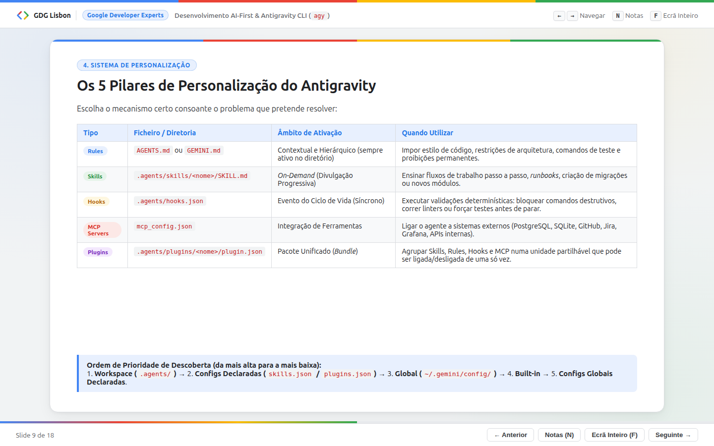

Choosing the right customization primitive for each engineering problem keeps your context lean and your guardrails deterministic:

| Pillar | File / Directory | Activation Scope | When to Use |
| :--- | :--- | :--- | :--- |
| **1. Rules** | `AGENTS.md` or `GEMINI.md` | Contextual & Hierarchical (always active in directory) | Enforce coding style, module boundaries, single-file test commands, and permanent constraints |
| **2. Skills** | `.agents/skills/<name>/SKILL.md` | *On-Demand* (Progressive Disclosure) | Teach multi-step workflows, DB migrations, endpoint scaffolding, or incident triage |
| **3. Hooks** | `.agents/hooks.json` | Synchronous Lifecycle Event (`stdin` -> `stdout`) | Block destructive shell commands, auto-run linters after file edits, or enforce tests before stopping |
| **4. MCP Servers** | `mcp_config.json` / `.agents/mcp.json` | External Tool Integration (`stdio` or Streamable HTTP) | Connect the agent safely to databases, service registries, GitHub, Jira, or internal APIs |
| **5. Plugins** | `.agents/plugins/<name>/plugin.json` | Unified Shareable Bundle | Package Skills, Rules, Hooks, and MCP servers into a single toggleable unit for the whole team |

**Discovery Priority Order (Highest to Lowest):**
1. **Workspace (`.agents/`)** &rarr; 2. **Declared Workspace Configs (`skills.json` / `plugins.json`)** &rarr; 3. **Global (`~/.gemini/config/`)** &rarr; 4. **Built-in** &rarr; 5. **Global Declared Configs**.

### Context Budget & Progressive Disclosure

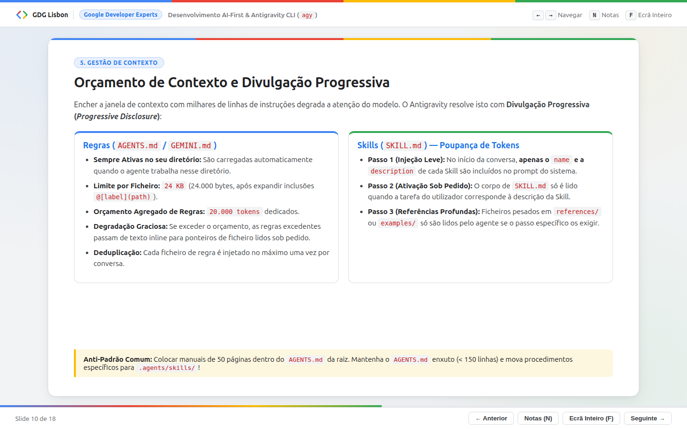

Stuffing thousands of lines of instructions into a single system prompt degrades model reasoning. Antigravity solves this with strict **Context Budgets** and **Progressive Disclosure**:

- **Rules (`AGENTS.md` / `GEMINI.md`)**:
  - **Per-File Limit**: `24 KB` (`24,000 bytes`, after expanding any `@[label](path)` inclusions).
  - **Aggregate Rule Budget**: `20,000 tokens` dedicated across active rule files.
  - **Graceful Degradation**: If active rules exceed the budget, lower-priority rules automatically degrade from inline text to on-demand file pointers.
  - **Deduplication**: Each rule file is injected at most once per conversation.
- **Skills (`SKILL.md`) — 3-Stage Token Savings**:
  1. **Stage 1 (Lightweight Startup Injection)**: Only the `name` and `description` from the YAML frontmatter of each skill are injected into the initial system prompt.
  2. **Stage 2 (On-Demand Activation)**: The body of `SKILL.md` is read only when the user's task matches the skill's `description`.
  3. **Stage 3 (Deep References)**: Heavy manuals in `references/` or sample files in `examples/` are read only if the specific workflow step requires them.

---

## 5-Lab Progressive Curriculum Roadmap

The repository includes five self-contained, progressive hands-on labs under `examples/` that take you from an empty project boilerplate to a full-stack Node.js + React application:

| Lab Directory | Architectural Focus | Key Primitives Demonstrated | Verification Command |
| :--- | :--- | :--- | :--- |
| **`examples/00-project-boilerplate/`** | Universal AI-First Project Skeleton | `AGENTS.md`, `product-spec.md`, `architecture.md`, `conventions.md`, `ADR-0001`, `init-project` & `feature-workflow` skills | `./.agents/skills/init-project/scripts/check-boilerplate.sh` |
| **`examples/01-starter-template/`** | Greenfield Python Modular Monolith | Concise root `AGENTS.md`, integer-cents domain rules, `project-bootstrap` skill, `PreToolUse` safety hook | `./.agents/skills/project-bootstrap/scripts/verify-env.sh` |
| **`examples/02-fullstack-monorepo/`** | Multi-Service Monorepo Scaling | Hierarchical `AGENTS.md` (Root + API + Web), `db-migration` & `api-endpoint-scaffold` skills, `PreToolUse` + `PostToolUse` hooks | `./.agents/skills/db-migration/scripts/validate-sql.sh apps/api/migrations/001_create_users.sql` |
| **`examples/03-team-plugin-and-mcp/`** | Team Governance, Plugins & MCP | Declarative `skills.json` & `plugins.json`, `platform-engineering-kit` plugin, local Python Stdio MCP server | `printf '{"jsonrpc":"2.0","id":1,"method":"tools/list","params":{}}\n' \| python3 tools/local-mcp-server/server.py` |
| **`examples/04-restaurant-reservation/`** | Production Full-Stack App (Node.js + React 19) | Contract-first schema (`contracts.json`), Node.js REST API (`:4000`), React 19 + Vite UI (`:5173`), `add-reservation-feature` skill | `npm test` & `npm start` |

---

## Prerequisites & Environment Setup

### 1. Installing Google Antigravity CLI (`agy`) & Configuring Authentication

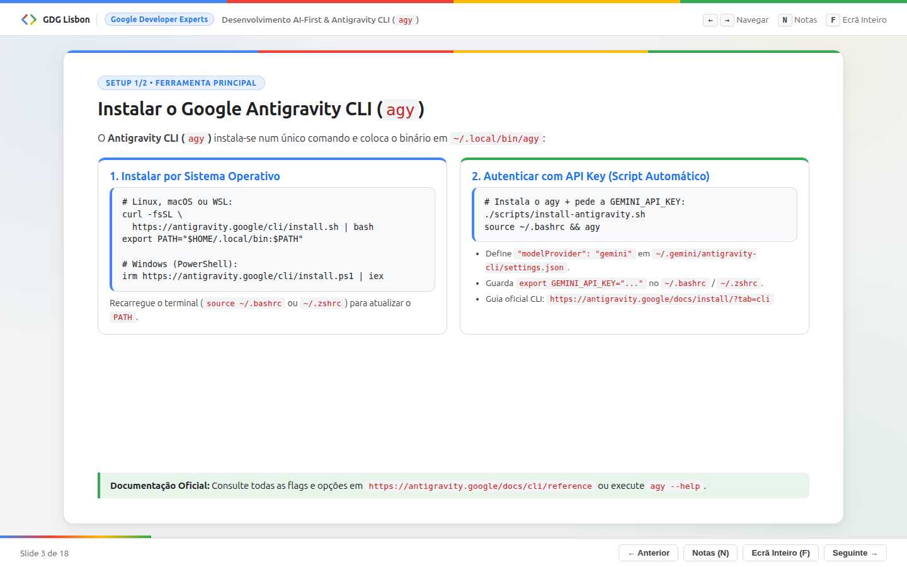

This repository includes an automated Bash installer script ([`scripts/install-antigravity.sh`](./scripts/install-antigravity.sh)) that checks whether `agy` is already installed, downloads it if missing, prompts securely for your `GEMINI_API_KEY`, sets `"modelProvider": "gemini"` in `~/.gemini/antigravity-cli/settings.json`, and persists the key in your shell profile (`~/.bashrc` / `~/.zshrc`):

```bash
# Option A: Automated check, install, and API key configuration
./scripts/install-antigravity.sh
source ~/.bashrc
agy --version
```

If you prefer manual installation:

```bash
# Linux, macOS, or WSL:
curl -fsSL https://antigravity.google/cli/install.sh | bash
export PATH="$HOME/.local/bin:$PATH"

# Windows (PowerShell):
irm https://antigravity.google/cli/install.ps1 | iex
```

> [!NOTE]
> Official CLI Installation & Reference Documentation:
> - Installation Guide: [`https://antigravity.google/docs/install/?tab=cli`](https://antigravity.google/docs/install/?tab=cli)
> - CLI Reference: [`https://antigravity.google/docs/cli/reference`](https://antigravity.google/docs/cli/reference)

### 2. Installing Python 3 & Node.js LTS (via NVM)

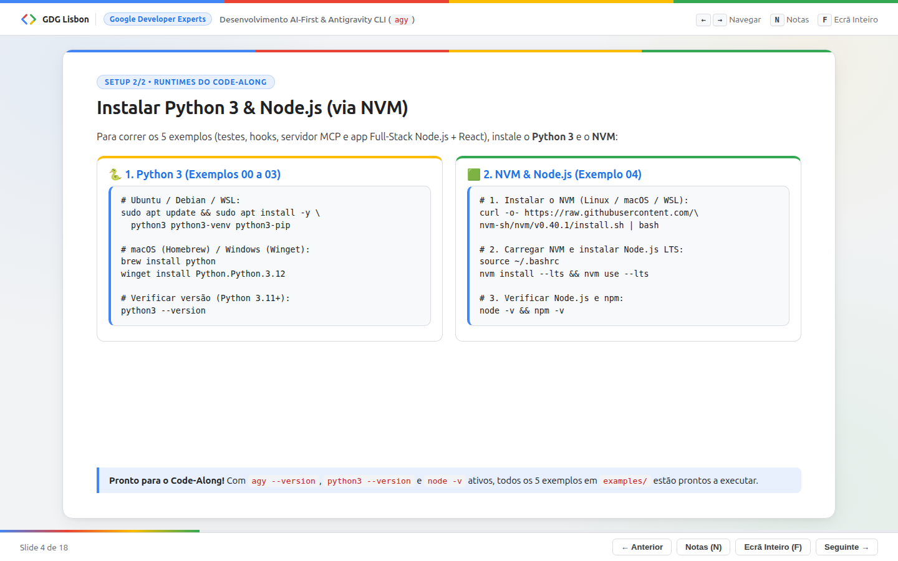

Labs `00` through `03` use **Python 3.11+** (zero external PyPI packages required—100% standard library), and Lab `04` uses **Node.js LTS** (for the REST API and React 19 + Vite frontend):

```bash
# 1. Verify or install Python 3 (Ubuntu / Debian / WSL)
sudo apt update && sudo apt install -y python3 python3-venv python3-pip
python3 --version

# 2. Install NVM and Node.js LTS
curl -o- https://raw.githubusercontent.com/nvm-sh/nvm/v0.40.1/install.sh | bash
source ~/.bashrc
nvm install --lts && nvm use --lts
node -v && npm -v
```

### 3. Mastering `agy` CLI Flags, Execution Modes & Slash Commands

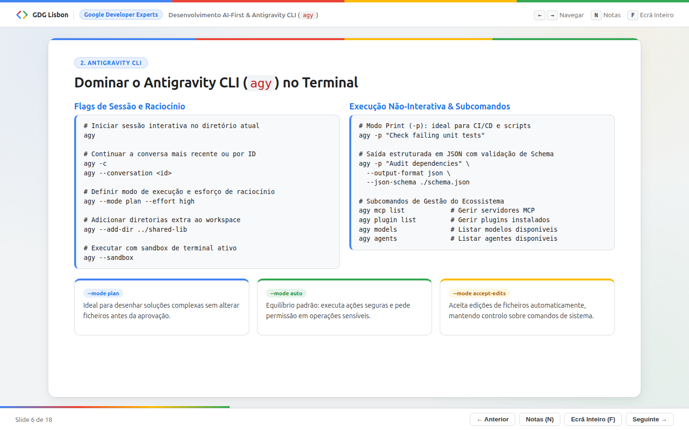

`agy` supports interactive pair-programming sessions, headless one-shot execution (`-p` / `--print`), sandboxed execution (`-s`), and customizable thinking effort (`-e`):

```bash
# Interactive TUI in the current repository
agy

# Headless execution (ideal for CI/CD pipelines and automated audits)
agy -p "Run the test suite and summarize any failures" --output-format json

# Execution modes (-m) and thinking effort (-e: low | medium | high | max)
agy -m plan -e high "Design the database schema for multi-tenant billing"

# Enable filesystem & network sandboxing
agy -s
```

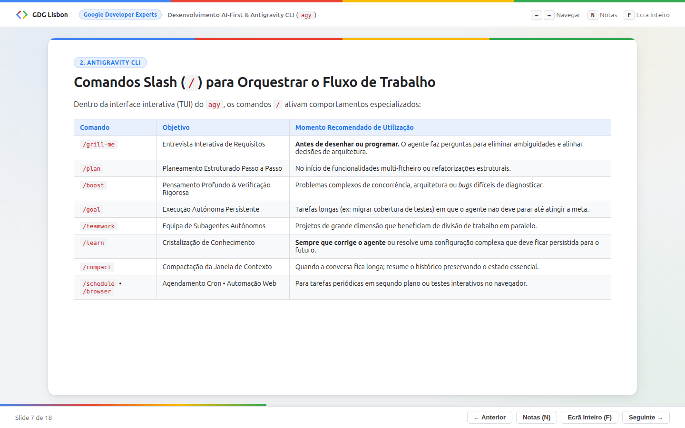

Inside an interactive `agy` session, use **Slash Commands** to orchestrate complex engineering lifecycles:

- **`/plan`**: Investigate the codebase and produce a structured implementation plan before touching any code.
- **`/grill-me`**: Trigger an interactive architectural interview to resolve edge cases and ambiguities before coding.
- **`/learn`**: Persist a convention, fix, or architectural pattern into `AGENTS.md` or `.agents/skills/` so the agent never repeats a mistake.
- **`/boost`**: Activate deep multi-perspective analysis and rigorous verification for complex bugs or refactors.
- **`/teamwork`**: Coordinate multiple autonomous subagents working in parallel across backend, frontend, and tests.
- **`/goal`**: Run a long-horizon task with exhaustive self-verification until all acceptance criteria pass.
- **`/compact`**: Summarize and compact conversation history to free up the context window before starting a new task.

---

## Deep Dive into the 5 Customization Primitives

### 1. Hierarchical Rules (`AGENTS.md` / `GEMINI.md`)

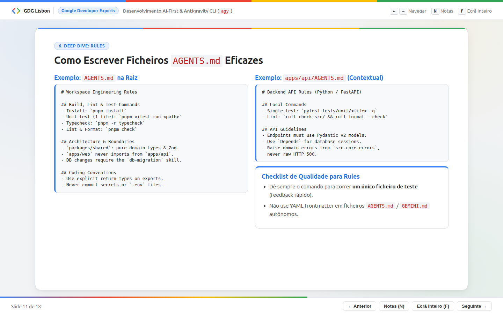

When `agy` edits a file (for example, `apps/api/src/routes.py`), it walks the directory tree from the current working directory down to the target file, combining the root `AGENTS.md` with directory-specific `AGENTS.md` files:

- **Root `AGENTS.md`**: Global tech stack, build/test/lint commands (especially the command to run a **single test file** for sub-second feedback), and cross-package architectural boundaries.
- **Subdirectory `apps/api/AGENTS.md` & `apps/web/AGENTS.md`**: Framework-specific conventions (e.g., FastAPI/Python error envelopes vs. React 19/TypeScript component rules).
- **Formatting Rule**: Standalone `AGENTS.md` and `GEMINI.md` files are pure Markdown—do **not** add YAML frontmatter to them.

### 2. Modular Workflows with Skills (`SKILL.md`)

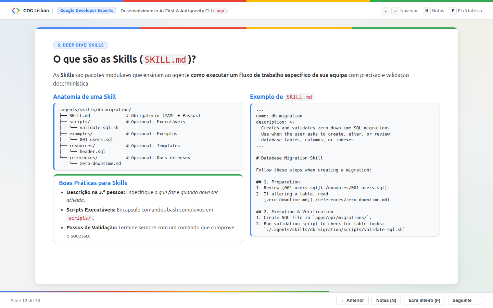

A **Skill** lives in `.agents/skills/<skill-name>/` and packages instructions alongside executable helper scripts and reference templates:

```text
.agents/skills/db-migration/
├── SKILL.md              # Required: YAML frontmatter (name, description) + numbered steps
├── scripts/              # Optional: Executable validation utilities (e.g., validate-sql.sh)
├── examples/             # Optional: Golden reference implementations (e.g., 001_create_users.sql)
├── resources/            # Optional: Boilerplate templates & assets
└── references/           # Optional: Deep-dive documentation read only when needed
```

Best practices for `SKILL.md` authoring:
1. **Write `description` in the 3rd person**: Clearly state *what* the skill does and *when* the agent must activate it (e.g., *"Creates and validates zero-downtime SQL database migrations. Use this skill whenever the user asks to create, alter, or review database tables..."*).
2. **Delegate complex shell logic to `scripts/`**: Have the agent invoke a deterministic script (`./.agents/skills/db-migration/scripts/validate-sql.sh <file>`) rather than improvising complex regexes in bash.

### 3. External Tooling via Model Context Protocol (`mcp_config.json`)

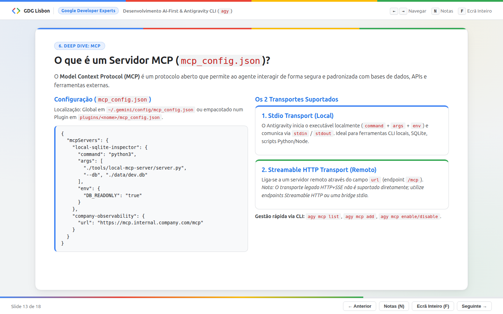

The **Model Context Protocol (MCP)** connects `agy` to external data sources and tools using two supported transports:
1. **Stdio Transport (Local)**: `agy` spawns a local binary or script (`command`, `args`, `env`) and communicates over `stdin` / `stdout` using JSON-RPC 2.0. Ideal for local SQLite/PostgreSQL inspectors, service registries, and internal CLI wrappers.
2. **Streamable HTTP Transport (Remote)**: Connects to a remote HTTP MCP endpoint via the `url` field (`https://mcp.internal.company.com/mcp`). *(Note: Legacy HTTP+SSE transport is deprecated; use Streamable HTTP or a local stdio bridge).*

### 4. Deterministic Guardrails via Lifecycle Hooks (`.agents/hooks.json`)

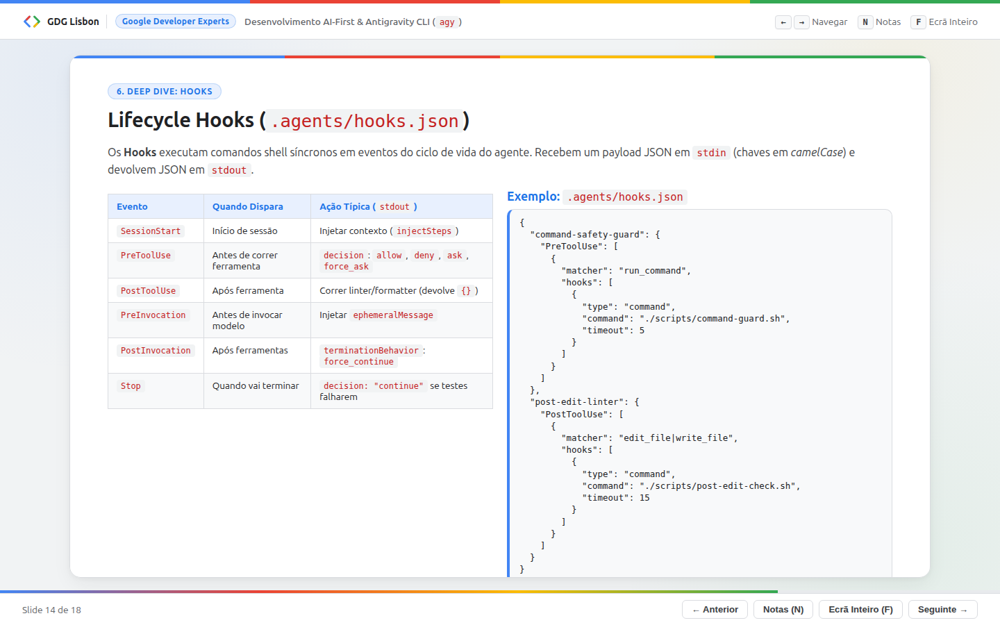

While `AGENTS.md` and `SKILL.md` guide the LLM's reasoning, **Lifecycle Hooks** enforce rules with **100% deterministic execution** outside the model. Hook scripts receive a JSON payload on `stdin` (with `camelCase` keys, plus compatibility fallbacks) and return a JSON decision on `stdout`:

| Lifecycle Event | Trigger Point | Typical Deterministic Action (`stdout` JSON) |
| :--- | :--- | :--- |
| **`SessionStart`** | Start of a new `agy` session | Inject initial environment status or active plugin banner (`injectSteps`) |
| **`PreToolUse`** | Before executing a tool (e.g., `run_command` / `Bash`) | Return `{"decision": "deny", "reason": "..."}` to block `rm -rf`, `git reset --hard`, or `DROP TABLE` |
| **`PostToolUse`** | Immediately after `edit_file` or `write_file` | Run syntax compilers (`python3 -m py_compile`, `node --check`) or linters automatically |
| **`PreInvocation`** | Before invoking the model | Inject an `ephemeralMessage` reminder |
| **`PostInvocation`** | After tool calls complete | Set `terminationBehavior: "force_continue"` if follow-up actions are required |
| **`Stop`** | When the agent loop is about to finish | Run unit tests and return `{"decision": "continue"}` if any test is failing |

### 5. Team Packaging with Plugins (`plugin.json`) & Declarative Configs (`skills.json`)

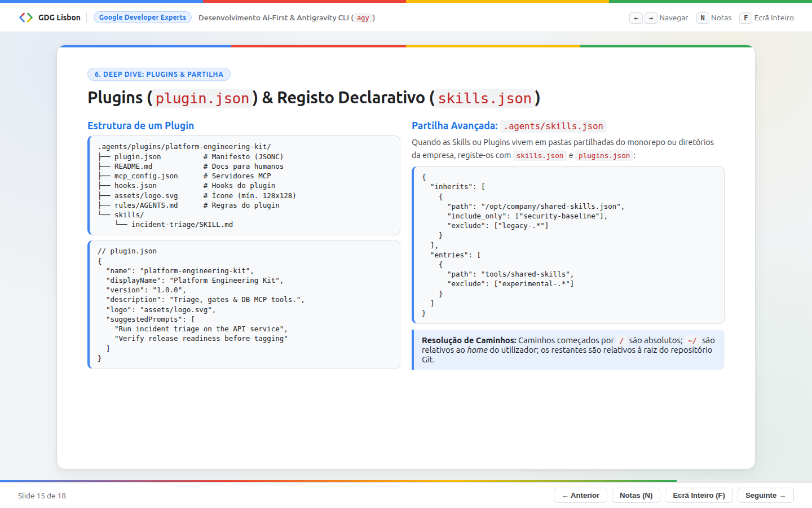

For platform engineering teams managing multiple repositories or monorepos:
- **Plugins (`.agents/plugins/<name>/plugin.json`)** bundle `rules/AGENTS.md`, `skills/`, `hooks.json`, `mcp_config.json`, and `assets/logo.svg` into a single versioned package with `suggestedPrompts`.
- **Declarative Registration (`.agents/skills.json` & `.agents/plugins.json`)** allows a project to inherit shared skills or plugins from another folder or central path (`/opt/company/...`, `~/...`, or repo-relative paths) with fine-grained `include_only` and `exclude` regex filters.

### 6. Day-to-Day Methodology: Greenfield vs. Brownfield

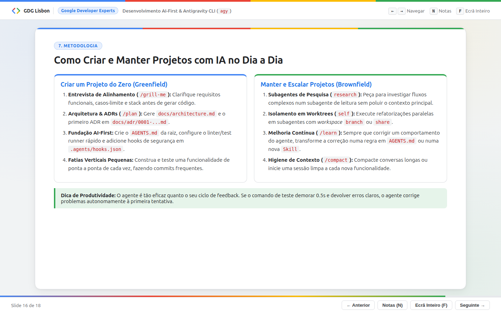

Whether starting a **Greenfield** repository from scratch or maintaining a complex **Brownfield** codebase, the workflow follows four disciplined habits:
1. **Plan Before Coding (`/plan` & `/grill-me`)**: Align on contracts, edge cases, and ADRs before writing implementation files.
2. **Contract-First Execution**: Update shared schemas (`schemas.json` / `contracts.json`) and SQL migrations first, then backend handlers, then frontend components.
3. **Single-File Fast Feedback**: Run targeted tests after every edit (`pytest tests/unit/test_x.py` or `node --test tests/api.test.js`).
4. **Continuous Codification (`/learn`)**: Turn every bug fix or review correction into a permanent test and rule/skill update.

---

## Hands-On Labs: Step-by-Step Instructions & What to Expect

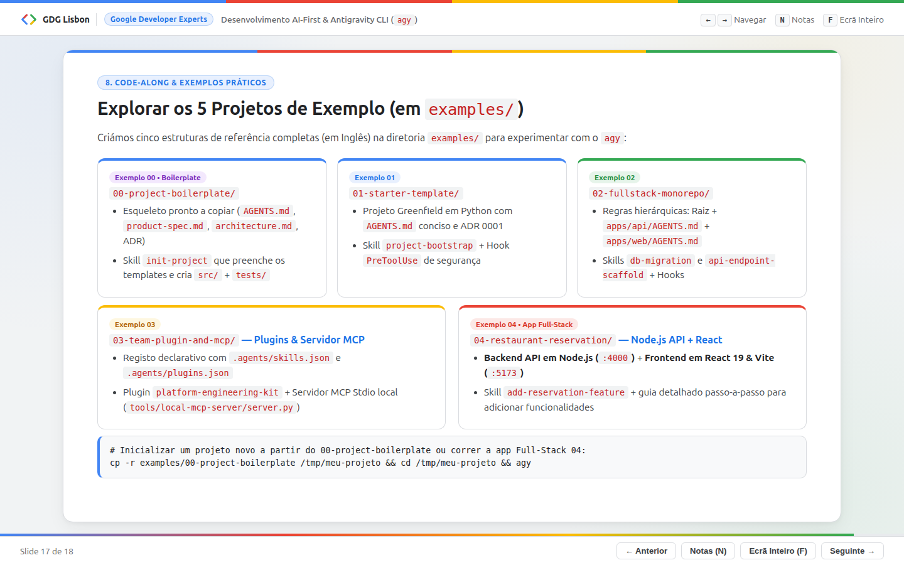

Below is the complete step-by-step walkthrough for all five hands-on projects in `examples/`.

---

## Lab 00: Universal AI-First Project Boilerplate (`examples/00-project-boilerplate/`)

**Architectural Goal**: Provide a language-agnostic starter skeleton (`00-project-boilerplate`) that you can copy (`cp -r`) to initialize *any* new software project with complete documentation templates, safety hooks, and two built-in workflow skills (`init-project` and `feature-workflow`).

### Directory Layout

```text
examples/00-project-boilerplate/
├── AGENTS.md                                      # Global AI rules template with [TODO] markers
├── docs/
│   ├── product-spec.md                            # Problem statement, personas, goals & non-goals
│   ├── architecture.md                            # Module map, boundaries & data flow
│   ├── conventions.md                             # Naming, testing, error handling & Git rules
│   └── adr/
│       └── 0001-initial-architecture-and-stack.md # ADR-0001 template
├── .agents/
│   ├── hooks.json                                 # PreToolUse safety + PostToolUse syntax check
│   ├── mcp.json                                   # MCP server template
│   ├── scripts/
│   │   ├── command-guard.sh                       # Blocks rm -rf, git reset --hard, DROP TABLE
│   │   └── post-edit-lint.sh                      # Auto-checks .py and .js files on save
│   └── skills/
│       ├── init-project/                          # Interviews user & replaces all [TODO] markers
│       │   ├── SKILL.md
│       │   └── scripts/check-boilerplate.sh
│       └── feature-workflow/                      # Spec -> Plan -> Code -> Test workflow
│           └── SKILL.md
├── src/
└── tests/
```

### Step 1: Audit the Uninitialized Boilerplate

Run the boilerplate audit script to inspect all required governance files and count remaining `[TODO: ...]` placeholders:

```bash
cd examples/00-project-boilerplate
./.agents/skills/init-project/scripts/check-boilerplate.sh
```

**What to Expect:**

```text
=== AI-First Boilerplate Readiness Audit ===
[1/2] Checking required directories and files...
  [OK] Directory exists: docs/
  [OK] Directory exists: docs/adr/
  [OK] Directory exists: .agents/
  [OK] Directory exists: src/
  [OK] Directory exists: tests/
  [OK] File exists: AGENTS.md
  [OK] File exists: docs/product-spec.md
  [OK] File exists: docs/architecture.md
  [OK] File exists: docs/conventions.md
  [OK] File exists: docs/adr/0001-initial-architecture-and-stack.md
  [OK] File exists: .agents/hooks.json
  [OK] File exists: .agents/mcp.json
[2/2] Scanning for unfilled [TODO: ...] placeholders...
  [WARN] Found 22 '[TODO: ...]' placeholders remaining across AGENTS.md and docs/.
         Run 'agy' and ask the agent to execute the 'init-project' skill to complete setup.
```

### Step 2: Copy the Boilerplate & Initialize a New Project with `agy`

```bash
cp -r examples/00-project-boilerplate /tmp/expense-splitter
cd /tmp/expense-splitter
agy
```

Enter the following prompt inside `agy`:

> `"Use the init-project skill to initialize this project as a CLI & library for splitting group travel expenses in Python 3.12 (stdlib only, unittest for tests, integer cents for all currency amounts)."`

**What to Expect:**
1. `agy` activates `.agents/skills/init-project/SKILL.md` and runs `check-boilerplate.sh`.
2. It replaces all 22 `[TODO: ...]` placeholders across `AGENTS.md`, `docs/product-spec.md`, `docs/architecture.md`, and `docs/adr/0001-initial-architecture-and-stack.md` with concrete specifications and exact `unittest` commands.
3. It creates the initial implementation in `src/` and unit tests in `tests/`.
4. As each `.py` file is written, the `PostToolUse` hook (`post-edit-lint.sh`) automatically verifies Python syntax via `python3 -m py_compile`.
5. Finally, the agent re-runs `check-boilerplate.sh`, confirming:
   `[OK] 0 '[TODO: ...]' placeholders remaining! All documentation is customized.`

---

## Lab 01: Greenfield Starter Template (`examples/01-starter-template/`)

**Architectural Goal**: Demonstrate a clean, initialized **Greenfield** Python project (an Order Invoice Totals Calculator) featuring a concise root `AGENTS.md`, an Architecture Decision Record (`ADR-0001`), the `project-bootstrap` skill, and a deterministic `PreToolUse` safety hook.

### Step 1: Run the Deterministic Environment Verification Script

```bash
cd examples/01-starter-template
./.agents/skills/project-bootstrap/scripts/verify-env.sh
```

**What to Expect:**

```text
=== [1/3] Checking Python runtime ===
Python 3.12.x
=== [2/3] Checking required AI-First documentation files ===
  [OK] AGENTS.md found
  [OK] docs/architecture.md found
  [OK] .agents/hooks.json found
=== [3/3] Running unit test suite ===
test_invalid_tax_rate_raises (test_main.TestInvoiceTotal.test_invalid_tax_rate_raises) ... ok
test_line_item_negative_price_raises (test_main.TestInvoiceTotal.test_line_item_negative_price_raises) ... ok
test_line_item_subtotal (test_main.TestInvoiceTotal.test_line_item_subtotal) ... ok
test_order_invoice_total_with_tax (test_main.TestInvoiceTotal.test_order_invoice_total_with_tax) ... ok
----------------------------------------------------------------------
Ran 4 tests in 0.001s

OK
=== Environment verification PASSED ===
```

### Step 2: Run the `project-bootstrap` Skill in `agy`

```bash
cd examples/01-starter-template
agy
```

Prompt inside `agy`:

> `"Run the project-bootstrap skill to verify this workspace and summarize the project architecture."`

**What to Expect:**
1. `agy` automatically loads the root `AGENTS.md` into context.
2. Through **Progressive Disclosure**, it matches your request against `.agents/skills/project-bootstrap/SKILL.md` and loads its instructions on demand.
3. The agent reads `docs/architecture.md` and `docs/adr/0001-use-modular-monolith-and-sqlite.md`, executes `./.agents/skills/project-bootstrap/scripts/verify-env.sh`, checks `references/onboarding-checklist.md`, and outputs a structured readiness report highlighting that all monetary amounts must use **integer cents (`int`)** to avoid IEEE 754 floating-point rounding bugs.

### Step 3: Implement a New Feature Guided by `AGENTS.md`

Prompt inside `agy`:

> `"Add a discount calculation helper calculate_discount_cents(subtotal_cents: int, discount_percent: int) -> int in src/main.py and add unit tests in tests/test_main.py."`

**What to Expect:**
- Without needing to remind the agent in your prompt, `agy` follows every constraint in `AGENTS.md`:
  - Uses integer arithmetic (`(subtotal_cents * discount_percent) // 100` or `round`) with `int` return types—never `float`.
  - Raises `ValueError` if `subtotal_cents < 0` or `discount_percent` is outside `0..100`.
  - Adds explicit Python type annotations and docstrings using only the Python standard library.
  - Runs `python3 -m unittest discover -s tests -p "test_*.py" -v` automatically to prove all unit tests pass.

### Step 4: Test the Deterministic `PreToolUse` Safety Hook

Simulate the agent attempting to run a destructive `git reset --hard` command:

```bash
printf '{"tool_name":"Bash","tool_input":{"command":"git reset --hard HEAD~1"}}' \
  | ./.agents/scripts/pre-tool-safety.sh
```

**What to Expect:**

```json
{"decision":"deny","reason":"Blocked by workspace safety hook: destructive rm -rf or git reset --hard is not permitted."}
```

---

## Lab 02: Scaling a Full-Stack Monorepo (`examples/02-fullstack-monorepo/`)

**Architectural Goal**: Scale AI-First engineering across a multi-service **Brownfield Monorepo** containing a Python backend (`apps/api`), a React/TypeScript frontend (`apps/web`), and shared JSON schemas (`packages/shared/schemas.json`), governed by **Hierarchical `AGENTS.md` files**, **Workflow Skills (`db-migration` and `api-endpoint-scaffold`)**, and **Dual Lifecycle Hooks (`PreToolUse` + `PostToolUse`)**.

### How Context Inheritance Works in this Monorepo

```text
examples/02-fullstack-monorepo/
├── AGENTS.md                        # Level 1 (Root): Cross-service boundaries & shared schema rules
├── packages/shared/schemas.json     # Single source of truth for API entity contracts
├── apps/
│   ├── api/
│   │   ├── AGENTS.md                # Level 2 (Backend): Python/FastAPI envelope & SQL migration rules
│   │   ├── migrations/001_create_users.sql
│   │   └── src/routes.py
│   └── web/
│       ├── AGENTS.md                # Level 2 (Frontend): TypeScript interfaces & pure UI helpers
│       └── src/App.tsx
└── .agents/
    ├── hooks.json                   # PreToolUse (command-guard.sh) + PostToolUse (post-edit-check.sh)
    └── skills/
        ├── db-migration/            # Zero-downtime SQL migration workflow + validate-sql.sh
        └── api-endpoint-scaffold/   # Contract-first API + Frontend scaffolding workflow
```

### Step 1: Validate an Existing SQL Migration

```bash
cd examples/02-fullstack-monorepo
./.agents/skills/db-migration/scripts/validate-sql.sh apps/api/migrations/001_create_users.sql
```

**What to Expect:**

```text
[PASS] Migration apps/api/migrations/001_create_users.sql passed all static zero-downtime checks.
```

### Step 2: Create a Zero-Downtime SQL Migration with `agy`

Launch `agy` inside `examples/02-fullstack-monorepo`:

```bash
cd examples/02-fullstack-monorepo
agy
```

Prompt inside `agy`:

> `"Create a new zero-downtime migration 002_add_projects_table.sql in apps/api/migrations/ for a projects table (id, name, owner_user_id, created_at) and validate it."`

**What to Expect:**
1. `agy` activates `.agents/skills/db-migration/SKILL.md`.
2. It inspects the golden example (`examples/001_create_users.sql`) and the zero-downtime manual (`references/zero-downtime-migrations.md`).
3. It creates `apps/api/migrations/002_add_projects_table.sql` starting with `-- Migration: 002_add_projects_table` and idempotent `CREATE TABLE IF NOT EXISTS projects (...)` statements.
4. It runs `./.agents/skills/db-migration/scripts/validate-sql.sh apps/api/migrations/002_add_projects_table.sql` and confirms `[PASS]`.

### Step 3: Scaffold a Full-Stack Endpoint Across `packages/shared`, `apps/api`, and `apps/web`

Prompt inside `agy`:

> `"Add a GET /v1/projects endpoint (list_projects) to apps/api/src/routes.py and add a ProjectSummary interface and renderProjectRow helper in apps/web/src/App.tsx."`

**What to Expect:**
1. **Contract-First (`packages/shared/schemas.json`)**: Guided by the root `AGENTS.md` and the `api-endpoint-scaffold` skill, the agent updates `packages/shared/schemas.json` first with the `Project` schema.
2. **Backend Context (`apps/api/AGENTS.md`) + `PostToolUse` Hook**: When editing `apps/api/src/routes.py`, the agent returns the standardized response envelope `{"data": [...], "meta": {"requestId": request_id, "count": ...}}` with `camelCase` keys. Immediately after `routes.py` is saved, `.agents/scripts/post-edit-check.sh` runs `python3 -m py_compile apps/api/src/routes.py` automatically.
3. **Frontend Context (`apps/web/AGENTS.md`)**: When editing `apps/web/src/App.tsx`, the agent applies the frontend rules, defining `export interface ProjectSummary` and a pure `renderProjectRow(project: ProjectSummary): string` function without importing backend code.

### Step 4: Verify the SQL `DROP TABLE` Safety Guard

```bash
printf '{"tool_name":"run_command","tool_input":{"command":"sqlite3 app.db \"DROP TABLE users;\""}}' \
  | ./.agents/scripts/command-guard.sh
```

**What to Expect:**

```json
{"decision":"deny","reason":"Blocked by monorepo safety hook: DROP DATABASE/TABLE and destructive rm -rf commands are prohibited."}
```

---

## Lab 03: Team Plugins, Declarative Registries & Local MCP Server (`examples/03-team-plugin-and-mcp/`)

**Architectural Goal**: Demonstrate how Platform Engineering teams package and distribute reusable AI capabilities across repositories using **Declarative Configs (`.agents/skills.json` and `.agents/plugins.json`)**, a **Bundled Plugin (`platform-engineering-kit`)**, and a **Zero-Dependency Local Python MCP Server (`tools/local-mcp-server/server.py`)**.

### Step 1: Test the Local Stdio MCP Server via JSON-RPC 2.0

Before launching `agy`, test the local MCP server directly from your terminal by piping JSON-RPC 2.0 requests into `stdin`:

```bash
cd examples/03-team-plugin-and-mcp

# 1. List available MCP tools
printf '{"jsonrpc":"2.0","id":1,"method":"tools/list","params":{}}\n' \
  | python3 tools/local-mcp-server/server.py | python3 -m json.tool

# 2. Query metadata for a specific service
printf '{"jsonrpc":"2.0","id":2,"method":"tools/call","params":{"name":"get_service_metadata","arguments":{"service_name":"inventory-worker"}}}\n' \
  | python3 tools/local-mcp-server/server.py | python3 -m json.tool
```

**What to Expect:**
The MCP server responds over `stdout` with the registered tools (`list_registered_services` and `get_service_metadata`) and returns the live service catalog entry for `inventory-worker`:

```json
{
  "service": "inventory-worker",
  "ownerTeam": "supply-chain-team",
  "tier": "tier-2",
  "status": "degraded",
  "version": "1.8.3",
  "environment": "local"
}
```

### Step 2: Run an Automated Incident Triage Session in `agy`

```bash
cd examples/03-team-plugin-and-mcp
agy
```

Prompt inside `agy`:

> `"Run an incident triage for our services, check the metadata of any degraded service via MCP, and generate a triage report."`

**What to Expect:**
1. **`SessionStart` Hook Injection**: On startup, the plugin hook (`session-banner.sh`) injects a system notification confirming that `platform-engineering-kit` is active with skills `incident-triage` and `release-readiness`.
2. **Diagnostic Script Execution**: The agent activates `incident-triage` and executes `./.agents/plugins/platform-engineering-kit/skills/incident-triage/scripts/collect-diagnostics.sh`, discovering that `checkout-api` is `healthy` (`p95LatencyMs: 42`), while `inventory-worker` is `degraded` (`p95LatencyMs: 890`, `errorRatePct: 2.40`, *"Database connection pool saturation at 92%"*).
3. **MCP Tool Call (`get_service_metadata`)**: The agent queries the `platform-engineering-kit-registry` MCP server for `inventory-worker`, retrieving `ownerTeam: "supply-chain-team"`, `tier: "tier-2"`, and `version: "1.8.3"`.
4. **Severity Matrix Classification**: Consulting `references/severity-matrix.md`, the agent classifies the incident as **SEV-2** (since `errorRatePct > 1%` and `p95LatencyMs > 500ms` on a `tier-2` service) and produces a blameless Markdown Incident Triage Report as required by `.agents/plugins/platform-engineering-kit/rules/AGENTS.md`.

### Step 3: Evaluate Release Readiness & Shared Security Audit Skills

Prompt inside `agy`:

> `"Evaluate whether inventory-worker is ready for production deployment using our release-readiness skill, and run a security audit using our security-audit skill."`

**What to Expect:**
- **Release Gate Scorecard (`BLOCKED`)**: Using `release-readiness`, the agent evaluates `inventory-worker` against `references/release-gate-criteria.md` and outputs a **`BLOCKED`** scorecard because the error rate (`2.40%`) exceeds the `< 0.5%` threshold and p95 latency (`890ms`) exceeds the `< 250ms` threshold.
- **Declarative Skill Inheritance (`.agents/skills.json`)**: The agent loads `tools/shared-skills/security-audit/SKILL.md` (which was registered via `.agents/skills.json` while excluding `experimental-.*` skills) and audits the repository for hardcoded secrets, unsafe shell hooks, and MCP privileges.

---

## Lab 04: Full-Stack Restaurant Table Reservation App (`examples/04-restaurant-reservation/`)

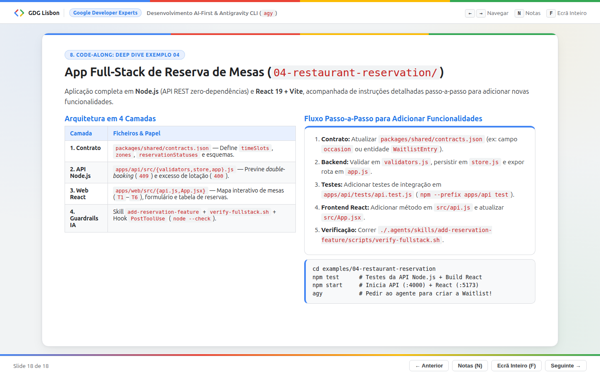

**Architectural Goal**: Experience AI-First engineering on a complete, runnable **Full-Stack Web Application** built with a **Node.js HTTP REST API (`apps/api`, port `4000`)**, a **React 19 + Vite Frontend (`apps/web`, port `5173`)**, and a **Contract-First Shared Schema (`packages/shared/contracts.json`)**.

### Full-Stack Architecture Overview

```text
examples/04-restaurant-reservation/
├── AGENTS.md                                      # Global contract-first & verification rules
├── package.json                                   # Workspace scripts: npm start, npm test, npm run build
├── docs/
│   ├── architecture.md                            # System diagram, table capacity map & data flow
│   └── adding-functionality-guide.md              # Step-by-step manual & AI guide for 3 new features
├── packages/
│   └── shared/
│       └── contracts.json                         # Single source of truth: Tables, Slots, Statuses
├── apps/
│   ├── api/                                       # Node.js HTTP REST API (Port 4000, zero external deps)
│   │   ├── AGENTS.md                              # Backend rules: envelope, status codes, validation
│   │   ├── src/
│   │   │   ├── validators.js                      # Pure input validation functions
│   │   │   ├── store.js                           # In-memory reservation & table state store
│   │   │   └── server.js                          # HTTP routing & CORS handler
│   │   └── tests/
│   │       └── api.test.js                        # 6 automated integration tests (node --test)
│   └── web/                                       # React 19 + Vite Frontend (Port 5173)
│       ├── AGENTS.md                              # Frontend rules: state flow, semantic attributes
│       └── src/
│           ├── api.js                             # Typed fetch wrapper for /api/v1/*
│           ├── App.jsx                            # Interactive floor plan, booking form & schedule
│           └── styles.css                         # Responsive UI styling
└── .agents/
    ├── hooks.json                                 # PreToolUse (command-guard.sh) + PostToolUse (node --check)
    └── skills/
        └── add-reservation-feature/               # 6-step full-stack feature implementation skill
            ├── SKILL.md
            └── scripts/verify-fullstack.sh        # Runs syntax check + 6 API tests + Vite prod build
```

### Step 1: Run the Full-Stack Verification Pipeline (`npm test`)

```bash
cd examples/04-restaurant-reservation
npm test
```

**What to Expect:**

```text
=== [1/3] Checking Node.js backend syntax ===
  [OK] Backend syntax check passed.
=== [2/3] Running Node.js API integration test suite ===
✔ GET /api/v1/health returns service status ok
✔ GET /api/v1/tables returns 6 tables with availability for date and slot
✔ POST /api/v1/reservations creates a reservation and marks table unavailable
✔ POST /api/v1/reservations rejects double-booking the same table and slot with 409
✔ POST /api/v1/reservations rejects partySize exceeding table capacity with 400
✔ PATCH /api/v1/reservations/:id/cancel frees the table for rebooking
ℹ tests 6
ℹ pass 6
ℹ fail 0
=== [3/3] Verifying React frontend production build ===
✓ 30 modules transformed.
dist/index.html                   0.48 kB
dist/assets/index-C0_uB6c4.css    4.28 kB
dist/assets/index-D6xK3p9a.js   194.15 kB
✓ built in 760ms
=== Full-stack verification PASSED ===
```

### Step 2: Launch the Full-Stack Application (`npm start`)

```bash
cd examples/04-restaurant-reservation
npm start
```

**What to Expect:**
- The **Node.js REST API** starts on **`http://localhost:4000`** (`GET /api/v1/health`, `GET /api/v1/tables`, `GET /api/v1/reservations`, `POST /api/v1/reservations`, `PATCH /api/v1/reservations/:id/cancel`).
- The **React 19 + Vite Dev Server** starts on **`http://localhost:5173`** (with `/api` automatically proxied to `http://localhost:4000`).
- Open **`http://localhost:5173`** in your browser:
  1. Select a **Date**, **Time Slot** (`17:30` to `21:00`), and **Party Size** (`1` to `8` guests).
  2. Observe the **Interactive Floor Plan** (`T1` through `T6` across Window, Main Hall, Patio, and Private Room zones):
     - Green cards (**`Available`**) can be clicked to select a table.
     - Red cards (**`Booked`**) indicate tables already reserved for that date and time slot.
     - Grey cards (**`Max N Guests`**) automatically disable tables whose capacity is smaller than the selected party size.
  3. Fill in the **New Reservation** form and click **Confirm Reservation**—the floor plan and the **Reservations Schedule** table update immediately.
  4. Click **Cancel** on any confirmed reservation to release the table back to **`Available`** in real time.

### Step 3: Extend the Application Using the 6-Step Contract-First Blueprint

Both [`examples/04-restaurant-reservation/README.md`](./examples/04-restaurant-reservation/README.md) and [`docs/adding-functionality-guide.md`](./examples/04-restaurant-reservation/docs/adding-functionality-guide.md) include three progressive extension labs that you can build either **with `agy`** (using the `add-reservation-feature` skill) or **manually**:

```text
Step 1: Shared Contract      -->  packages/shared/contracts.json
Step 2: Pure Validation      -->  apps/api/src/validators.js
Step 3: Store / Business     -->  apps/api/src/store.js
Step 4: HTTP Route Handler   -->  apps/api/src/server.js
Step 5: Automated API Tests  -->  apps/api/tests/api.test.js
Step 6: React Client & UI    -->  apps/web/src/api.js + apps/web/src/App.jsx
```

#### Extension Exercise A: Add `occasion` & `dietaryNotes` to Reservations
Launch `agy` inside `examples/04-restaurant-reservation`:

```bash
cd examples/04-restaurant-reservation
agy
```

Prompt inside `agy`:

> `"Use the add-reservation-feature skill to add an 'occasion' field (none, birthday, anniversary, business) and a 'dietaryNotes' field (max 200 chars) to reservations across contracts.json, the Node.js API, API tests, and the React booking form and schedule table."`

#### Extension Exercise B: Add a Full-Stack Waitlist Queue (`POST /api/v1/waitlist`)
Prompt inside `agy`:

> `"Use the add-reservation-feature skill to implement a Waitlist feature (GET /api/v1/waitlist and POST /api/v1/waitlist) in the backend store and server, add integration tests in apps/api/tests/api.test.js, and add a 'Join Waitlist' panel in apps/web/src/App.jsx when tables are full."`

#### Extension Exercise C: Add VIP Table Badge & Minimum Spend Rule (`partySize >= 4`)
Prompt inside `agy`:

> `"Use the add-reservation-feature skill to mark Table T6 (Private Room) as isVip: true in contracts.json, enforce a minimum partySize of 4 for VIP tables in the backend store with a 400 validation error, add an API test, and render a gold VIP badge on VIP table cards in React."`

**What to Expect After Every Exercise:**
- Every time `agy` edits a `.js` file in `apps/api/`, the `PostToolUse` hook (`.agents/scripts/post-edit-check.sh`) runs `node --check` automatically.
- At the end of the workflow, `agy` executes `./.agents/skills/add-reservation-feature/scripts/verify-fullstack.sh`, verifying that all backend tests (`node --test`) and the production React build (`vite build`) pass with zero errors.

---

## Instructor Troubleshooting & Common Traps

If participants encounter issues during the live Code-Along session, use this quick diagnostic matrix:

| Symptom / Error | Root Cause | Immediate Fix |
| :--- | :--- | :--- |
| `agy: command not found` | `~/.local/bin` is not in the current shell's `PATH` | Run `./scripts/install-antigravity.sh && source ~/.bashrc` or `export PATH="$HOME/.local/bin:$PATH"`. |
| Authentication / API Key prompt error | `GEMINI_API_KEY` not exported or `modelProvider` not set | Re-run `./scripts/install-antigravity.sh`, which configures `~/.gemini/antigravity-cli/settings.json` and `~/.bashrc`. |
| `EADDRINUSE: address already in use :4000` | Previous instance of Lab 04 API server still running | Run `lsof -ti:4000 \| xargs kill -9` (or set `PORT=4001`). |
| `Permission denied` when running `.sh` scripts | Git clone stripped executable bit on shell scripts | Run `chmod +x scripts/*.sh examples/*/.agents/scripts/*.sh examples/*/.agents/skills/*/scripts/*.sh`. |
| Agent ignores a newly created `SKILL.md` | Missing YAML frontmatter (`name` and `description`) | Ensure `SKILL.md` begins with `---`, `name: <kebab-case>`, `description: ...`, `---` on line 1. |
| Hook script fails or blocks unexpectedly | Hook script printed non-JSON debug text to `stdout` | Send all diagnostic logs in hook scripts to `stderr` (`>&2`) and output **only** valid JSON on `stdout`. |

---

## Key Architectural Takeaways

1. **Context Engineering Beats Prompt Engineering**: Version-controlled, hierarchical `AGENTS.md` files (`< 150 lines` each, within the `24 KB` per-file / `20,000-token` aggregate budget) eliminate repetitive prompting and keep the model aligned with your architecture across every directory.
2. **Progressive Disclosure Scales Team Knowledge**: Packaging complex workflows into `.agents/skills/<name>/SKILL.md` with companion validation scripts (`scripts/`) and deep manuals (`references/`) gives the agent rich procedural expertise while consuming almost zero tokens when idle.
3. **Deterministic Hooks Enforce Non-Negotiable Guardrails**: Combining `PreToolUse` safety guards (`command-guard.sh`), `PostToolUse` syntax checks (`post-edit-check.sh`), and **Model Context Protocol (MCP)** servers turns an LLM into a reliable, production-grade engineering partner.

---

### Special Thanks

- **[GDG Lisbon (Google Developer Group Lisbon)](https://gdg.community.dev/gdg-lisbon/)**
- **[Google Developer Experts (GDE) Program](https://developers.google.com/community/experts)**

---

## Resources & Community Links

- **Official Antigravity CLI Installation Guide**: [antigravity.google/docs/install/?tab=cli](https://antigravity.google/docs/install/?tab=cli)
- **Official Antigravity CLI Reference**: [antigravity.google/docs/cli/reference](https://antigravity.google/docs/cli/reference)
- **Author's Technical Blog & Cloud Architecture Guides**: [nja.dev](https://nja.dev)
- **Interactive Architecture Diagramming**: [DrawIt by NJA (`drawit.nja.dev`)](https://drawit.nja.dev/)
- **Speaker Profile**: [Nuno João Andrade on LinkedIn](https://www.linkedin.com/in/nuno-andrade-964b2416)
- **GDG Lisbon Community**: [gdg.community.dev/gdg-lisbon](https://gdg.community.dev/gdg-lisbon/)
